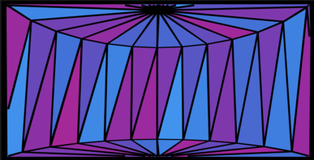

# Reflective Journal
My thoughts and reflections on the bodies of work done in CART 253...

## 2026/10/08 - Website Prototype

I originally joined the class later in the semester, and with the help of my prof, she showed me how to use GitHub Pages, which is something I had never used, so it took some time to acclimate. I find GitHub Pages to be a useful tool, and in the future I would rely on it for portfolio purposes. The linking of pages is similar to using pure html, which came in handy!

The process of creating a repo was easy since I already had prior experience doing so. When creating a repo, I did not use the terminal (git bash) but instead directly through GitHub and with HTTPS. I grappled with the thought of using GitKraken to write my commits instead of GitHub, but I opted for the extension for GitHub directly in VS Code for simplicity. Something I enjoy in life, and when it comes to projects, is organization, so creating all the folders was therapeutic. One for Challenges, Prototypes, and Classwork. 

When choosing visuals for my website, I wanted it to look clean with a flashy banner. I relied on the resources provided in the assignment documentation for its syntax. Although I wish I had leaned more into stylization because the website felt as if it was lacking some personality, especially in font type and color. However, I cannot directly use CSS with markup, which I did attempt earlier.

  
---

## 2026/10/10 - Representational, Abstract, and Really Weird Prototype 

For " House is home," I created a static image of a house using basic shapes like rectangles and one triangle. By looking up references on p5, I used rectMode(CENTER) for all the rectangles so the new center position of the rectangle was 400,400 when making the windows. When making the roof, I had originally written the wrong points because in my head the triangle was positioned from its center like the rectangles.  I later realized I confused the two when messing around with arbitrary numbers. I like the use of color, and I hope people might recognize it's a nod to “Painted Ladies”. I would further develop it by making window ridges, a more detailed roof, and a door with a doorknob.

For the abstract prototype, I took a more experimental approach, not really 100% knowing which direction I was heading in. With the help of p5 resources, I experimented with geometry. I had prior knowledge of WebGL from around a year ago, so I was a little rusty with the syntax. I was surprised when a third color was added to lerp that it became like an emissive color. Once I decided on a cylinder, I zoomed in the camera position to emulate being trapped in a stained glass illusion. I hope that people have fun playing with the mouse back and forth until they get dizzy, as I have. I would further improve this maybe by incorporating more colors.

Lastly, for the very weird prototype, I immediately thought of adding eyes to the piece. I searched for eye assets on itch and as well as an image with multiple eyes to potentially slice. I went with a sprite sheet and turned it into a gif using bulkpic. I looked at p5 resources to check how to use images or if gifs were supported. I learned how to load images with an async setup. I was surprised that resize changes the image/gif size for every single one. I like how each time you load the project, the eyes size and position are different. I hope people feel uneasy with all the eyeball gifs. I would add different color variations on the eyeballs and eyeballs following the user's cursor.

### Representational

### Abstract

### Really Weird

---

## 2026/10/11 - Variable Prototypes

### Variable01

For the bunny prototype, I decided to create a bunny face. The eyes took more finagling, and I learned to create evenly spaced ellipses. I also used stroke and stroke weight for the first time to create leaves. I played with the values to get the desired result. A bad habit I have is adding arbitrary values sometimes for my variables and tweaking them as I go. Alongside, I kept adding additional variables that weren't necessary, making the bunny not move as one and breaking it down into different parts. I hope people find it cute and a little silly. I would attempt turning this into an interactive experience where the bunny chases the carrot using WASD for movement.

### Variable02

For the heart prototype, I learned how to create a beating heart using p5.  For making the heart shape, I approached it by breaking it down into 3 shapes (2 circles and a triangle). The easy part consisted of changing the heart color. The following step was having it grow as the mouseX and mouseY go towards the bottom of the screen. What surprised me is for growing as the mouse drags that if I didn't include mouseY, the heart would turn upside down because the values of the heart became negative. The hardest part was including a beating heart using frameCount and combining the other effects. I hope people enjoy the meaning of this piece, that love permanently changes you. I would further develop this idea by adding sound effects to the heart and perhaps trying to draw an anatomically accurate heart using shapes.

### Variable03

For "Let me in", I wanted to explore a spookier subject matter. Although the drawing itself is a simple door, doors collectively have so many metaphors, whether it's something we avoid behind a locked door or opening doors and opportunities. I learned to use palette lerp with the help of p5, since from a previous project lerpColor was only able to combine 2 colors. What surprised me was pallette lerp is a very customizable function with time, colors, how long each color can appear for, and looping it with modulo. I hope people get a bit creeped out. I would love to develop this further by adding multiple doors and adding monsters behind some of them, with humans behind others.

---

## 2026/10/19 - Conditional Prototypes

### Conditional 01
.png>)

### Conditional 02

### Conditional 03

